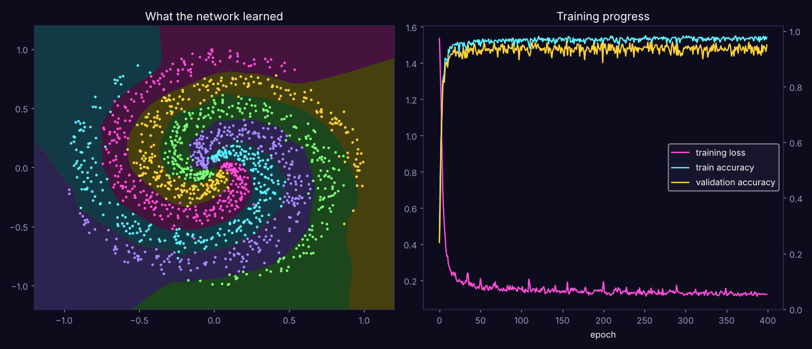

# Neural Network from Scratch (Python + numpy)

A working deep-learning library written with **only numpy**: no PyTorch, TensorFlow, or scikit-learn. It learns to separate a 5-arm spiral, a classic problem that no straight line can solve.



## Run it
```bash
pip install numpy matplotlib
python train_spiral.py
```
Training takes about 10 seconds. You'll see the gradient check, training logs, and a saved `spiral_result.png`.

## What's implemented (`nn.py`)
| Piece | Details |
|---|---|
| Dense layers | `y = x·W + b` with He initialization |
| ReLU activation | with its derivative for backprop |
| Softmax + cross-entropy | numerically stable, combined gradient `probs − one_hot` |
| **Backpropagation** | chain rule through every layer, written by hand |
| **Adam optimizer** | momentum + adaptive learning rates with bias correction |
| L2 regularization | weight decay to reduce overfitting |
| Mini-batch training | shuffled batches every epoch, train/validation split |
| **Gradient check** | compares backprop to numerical derivatives to prove the math is right |

## Results
```
Gradient check relative error: 2.07e-11  (PASS)
epoch    1  loss 1.5366  train acc 24.5%  val acc 24.0%
epoch   50  loss 0.1701  train acc 96.8%  val acc 92.0%
epoch  400  loss 0.1231  train acc 97.7%  val acc 95.0%
```
Random guessing would score 20%. The network (2 → 96 → 96 → 5) reaches about 95% on points it never trained on.

## Why the gradient check matters
Backprop bugs are silent: the network still trains, just badly. The check nudges every weight by ±0.00001, measures how the loss changes, and compares that to the gradient backprop computed. An error around 1e-11 means the two agree, so the calculus is correct.
