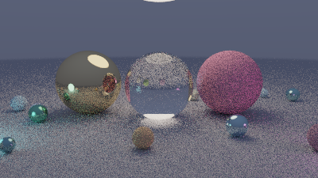

# Path Tracer (Python + numpy)

A physically based renderer that simulates how light actually bounces. Every pixel fires many random rays; each one bounces between surfaces until it reaches a light or escapes to the sky. Averaging them produces realistic soft shadows, reflections, refraction, color bleeding, and depth of field.


*400×225 at 40 samples per pixel (20 seconds). The grain fades as you raise `--spp`.*

## Run it
```bash
pip install numpy
python raytracer.py                              # quick preview
python raytracer.py --width 960 --spp 256        # high quality (a few minutes)
```
It saves `render.png` using only the standard library (it writes the PNG bytes itself with `zlib`).

## Materials
| Material | Physics |
|---|---|
| **Diffuse** | Cosine-weighted random bounce (Lambertian) |
| **Metal** | Mirror reflection, blurred by a roughness value |
| **Glass** | Snell's law refraction, total internal reflection, and Fresnel reflections via Schlick's approximation; the big ball is hollow |
| **Light** | Emissive spheres; the scene is lit only by these and a dim sky |

## Techniques
- **Monte Carlo path tracing**: up to 8 bounces per ray
- **Vectorized with numpy**: traces about 40,000 rays at once instead of one at a time in a Python loop
- **Russian roulette**: randomly ends dim paths, boosting the survivors so the image stays unbiased
- **Depth of field**: rays start from random points on a lens aperture
- **Anti-aliasing**: each sample is jittered inside its pixel
- **Tone mapping + gamma correction** so bright lights don't clip harshly
