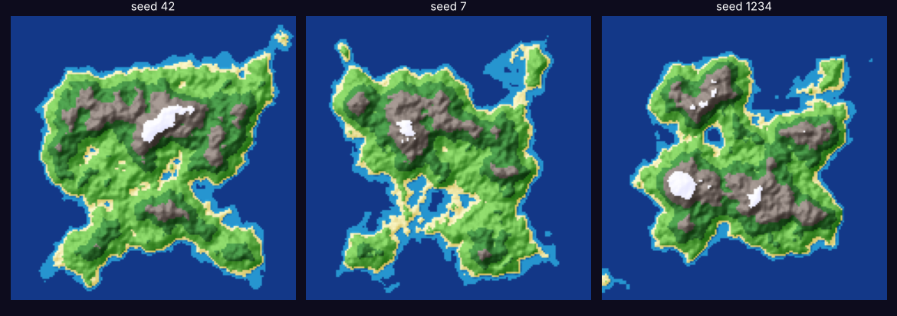

# Procedural Island Generator (Unity, C#)

Generates endless unique low-poly islands from math. Change the **seed** and you get a brand-new island. Every slider rebuilds the island live in the editor, even before you press Play.

*Three seeds rendered with the same algorithm (Python port used for this preview).*

## Scripts
| Script | What it does |
|---|---|
| `Noise.cs` | **Fractal Brownian motion**: stacks 5 octaves of Perlin noise (big mountains → small bumps), plus an island falloff mask |
| `TerrainGenerator.cs` | Builds the mesh (up to 375k vertices), colors it by biome, applies a height curve, and supports flat or smooth shading and scrolling terrain |
| `ObjectScatterer.cs` | Places trees and rocks only at the right heights and on gentle slopes, with minimum spacing so nothing overlaps |
| `VertexColorLit.shader` | Lit shader that displays the biome colors (Built-in pipeline) |

## Biomes
Deep water → Shallows → Sand → Grass → Forest → Rock → Snow, each with an editable color and height threshold in the Inspector.

## Setup (about 3 minutes)
1. Copy the `Assets` folder into a Unity project (2021.3 or newer, including Unity 6).
2. Create an empty GameObject and add **TerrainGenerator**. An island appears right away.
3. Create a material that shows vertex colors:
   - **Built-in pipeline:** use the included `Custom/VertexColorLit` shader.
   - **URP:** make a Shader Graph (Lit), add a **Vertex Color** node, and connect it to **Base Color**.
4. Drag the material onto the island's MeshRenderer.
5. Tweak the sliders, or right-click the component header and choose **Randomize Seed**.
6. Optional: add **ObjectScatterer**, give it tree prefabs, then right-click it and choose **Scatter**.

**Flyover effect:** set `Scroll Speed` to something like (3, 0) and press Play to glide over endless terrain.

## Key parameters
| Setting | Effect |
|---|---|
| Seed | Which island you get |
| Noise Scale | Zoom level of the noise (bigger means broader features) |
| Octaves / Persistence / Lacunarity | How much fine detail is layered on top |
| Falloff Strength | Lower values make a bigger island |
| Height Curve | Keeps beaches flat and makes mountains steep |
| Flat Shading | Faceted low-poly look vs. smooth hills |
